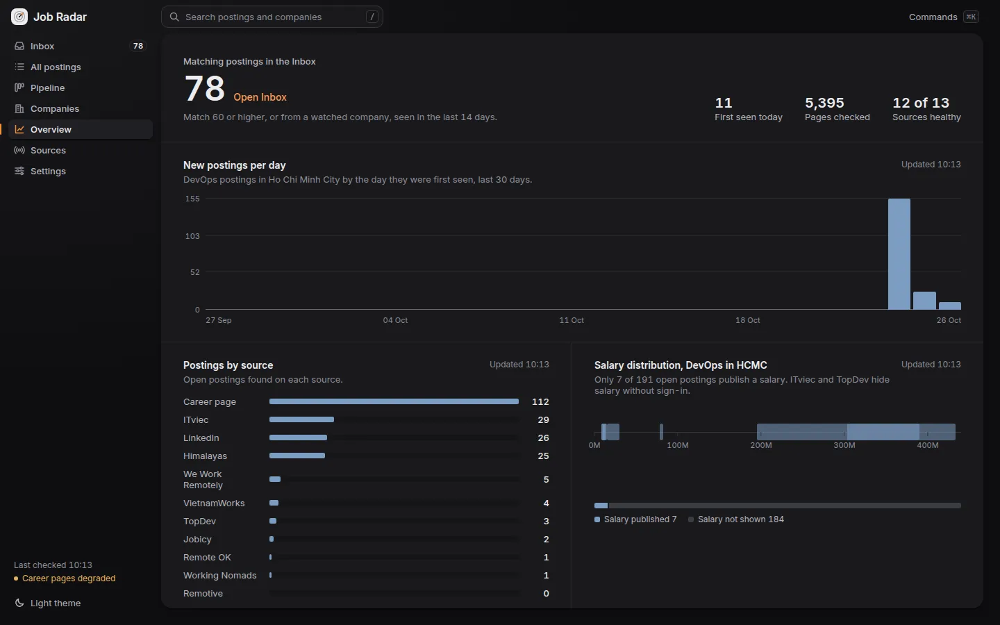
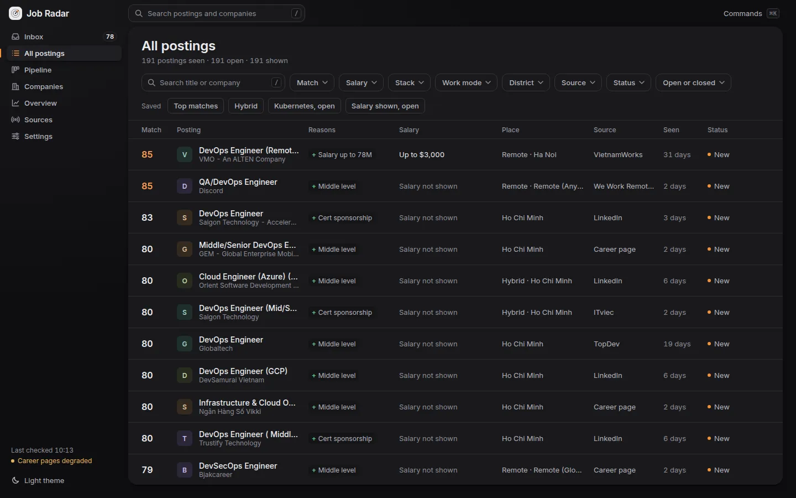
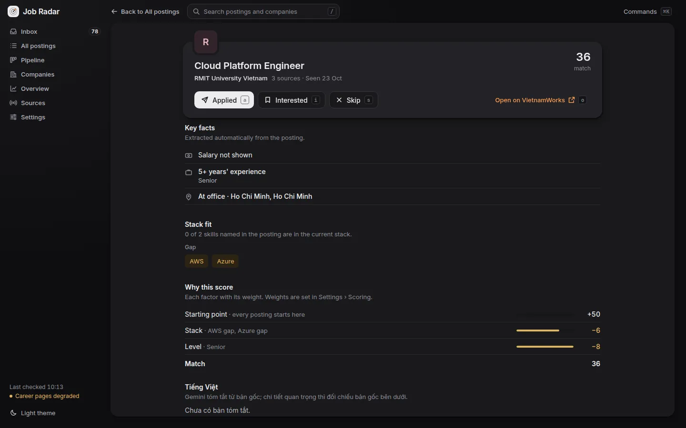
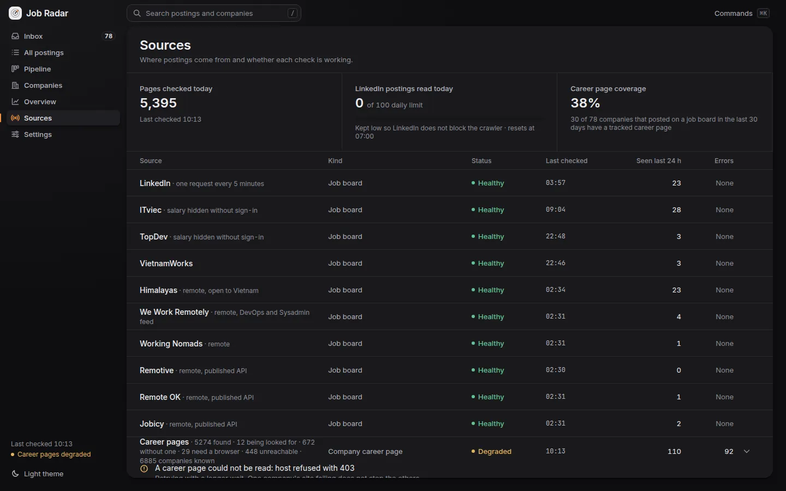
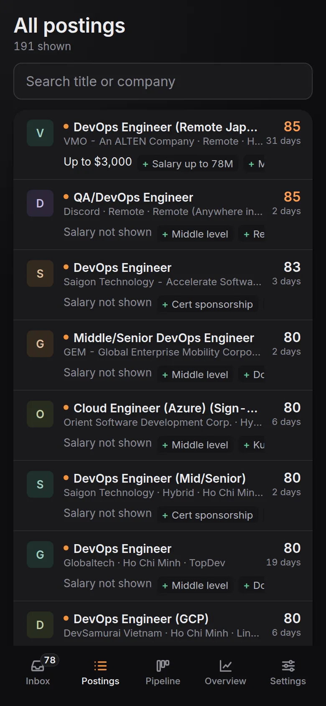

# Job Radar

A personal job radar for a DevOps engineer in Ho Chi Minh City: a **focused crawler** that reads the job boards, finds
and follows company sites by itself, reads their career pages, judges how far each page, site and posting can be
trusted, scores every posting against the owner's criteria, learns from the owner's triage, and shows the result in a
web inbox.

Self-hosted on one ARM node (Oracle Cloud, 4 OCPU / 24 GB) with Docker Compose. The running instance is private
(reachable only inside my Tailscale network); the code is public to show how it is built and run.

| Overview | All postings |
|---|---|
|  |  |
| **Posting detail** | **Sources** |
|  |  |



## What it does

- **Sources:** LinkedIn (guest pages), ITviec, TopDev (API), VietnamWorks (API), the TopDev company directory for
  Ho Chi Minh City, remote boards abroad (Himalayas, We Work Remotely, Working Nomads, and the published APIs of
  Remotive, Remote OK and Jobicy; only roles open to someone in Vietnam), and each company's own career page:
  Greenhouse, Lever, Workday and SmartRecruiters through their APIs, self-built pages through their job links,
  JavaScript-only pages through headless Chromium.
- **Discovery:** links from company pages to other sites (sister companies, partners, clients) and a monthly scan of
  the Common Crawl columnar index for `.vn` sites with a careers page become candidates; each is judged once (rules,
  with Gemini for the uncertain middle) and kept only if it is an IT company in Vietnam or one hiring remotely; at
  most two hops from a known company.
- **Best-first frontier:** each company has a relevance score (DevOps postings seen, watchlist, ATS, remote hiring,
  the owner's triage); relevant companies are read first and every 6 or 12 hours, every company at least daily.
- **Trust:** posting pages graded by their sections (LLM second opinion when unsure), a website match score per
  company (name in the address, source, contact e-mail domain, name and tax code on the page), and flags on stale,
  reposted, recruiter and missing-from-the-careers-page postings.
- **Learning from triage:** Interested / Applied / Skip decisions train a per-feature model (skills, company, level,
  work mode, English, source, salary band) that nudges new scores within ±15, growing with the number of decisions.
- **Company registry that grows by itself:** every company seen in a posting is recorded; its website comes from
  TopDev, a VietnamWorks profile, a matching contact e-mail in the posting, or the owner. The career page is then
  found from the website.
- **Extraction and scoring:** salary, level and years, work mode, stack, English requirement, certification
  sponsorship and onsite-abroad offers are read with rules; every point of the 0–100 match carries its reason.
  The owner tunes category weights on the Settings screen and every stored posting is rescored.
- **Vietnamese for English postings:** a summary (what the job is, main requirements, benefits, catches) made by
  Gemini when an English posting reaches the Inbox, and a full translation on request; both stored once.
- **Web inbox:** triage with Interested / Skip / Applied (keyboard `j k i s a o`, ⌘K, Undo), a drag-and-drop
  pipeline, filters, company pages, an overview of the market, and a health screen for every source.

## Architecture

The design follows the web crawler chapter of *System Design Interview* (Alex Xu, vol. 1), scaled to one user.

| Crawler building block | Here |
|---|---|
| Seed URLs | Job-board searches, the TopDev directory, and the company registry |
| URL frontier, politeness | `crawl_queue` in Postgres, claimed with `SELECT … FOR UPDATE SKIP LOCKED` together with the host row; each host has its own interval and pause |
| HTML downloader, robots.txt | Node `fetch` with a 5 MB body cap; robots.txt cached per host for a week and honoured on company sites (an unreachable robots.txt closes the site for an hour) |
| Content parser | One adapter per source; ATS JSON APIs; job links on self-built pages; a capped LLM fallback (Gemini through 9Router) only when postings are listed without links |
| Content seen? | SHA-256 of the main text of a page: unchanged pages are not parsed again and wait twice as long (1 day up to 7 days) |
| URL seen? | `(source, external_id)` of stored postings plus `rejected_postings`, so search pages do not send the crawler back to what was already read |
| URL extractor, URL filter | Outbound links from company pages and the Common Crawl index become `domain_candidates`; a topic filter (rules + capped LLM) keeps IT companies; two hops at most (spider-trap guard) |
| Prioritiser | Company relevance sets queue priority and read interval (best-first) |
| Storage | Postgres 18: companies, career pages, candidates, hosts, queue, jobs, sources, applications, preferences, learned model |

Refusals (429/403) pause the host for 15 minutes, doubling with each refusal in a row up to 6 hours, without
spending the task's retry attempts; "Try now" on the Sources screen probes the host and lifts the pause.

Services: `db` (Postgres), `crawler` (worker loop), `web` (JSON API and the React screens), together limited to
1.5 CPU and 2 GB so they never compete with the other workloads on the node.

## Run

```sh
cp .env.example .env   # set POSTGRES_PASSWORD, DATABASE_URL, LLM_* (optional)
docker compose up -d --build
docker compose --profile test run --rm --build test   # unit and integration tests against a throwaway database
```

Operator commands: `docker compose exec crawler node dist/src/cli.js rescore | sync-companies | enqueue <kind> <url> | matches [days] | import-candidates < tsv`.
`tools/common-crawl-import.sh` runs the Common Crawl scan (a systemd user timer runs it on the 5th of each month).

## Operations

- **Deploy:** through the Fleet Pulse canary controller (`fleet-pulse-deploy job-radar` on the node): the new web
  version takes 10% of requests for 10 minutes and is compared with the running one (5xx/timeouts and p95), then
  promoted with no downtime or rolled back automatically. A release that adds a migration is refused by the
  canary (both versions share the database); additive migrations go out with `--skip-canary`.
- **Health and SLO:** `GET /health` answers 503 when no task has finished for six hours. Fleet Pulse probes it every
  minute and holds Job Radar to a 99.5% availability SLO over 30 days.
- **Failure containment:**
  - Response bodies over 5 MB are refused while streaming, before they are buffered (robots.txt included).
  - A task cut off mid-run three times in a row, by a worker crash or a hang, is quarantined for a day instead of
    being picked up on every restart. Both came out of a real incident on 24 Oct 2026: a 22.8 MB company homepage
    ran the crawler out of heap and crash-looped it for 5.5 hours.
  - A crash loop now pages within minutes (`ContainerCrashLooping` in the fleet alert rules).
- **Logs:** container stdout, collected by Promtail into Loki.
- **Backup:** `pg_dump` in the node's nightly Kopia backup, plus a dump before every data change or migration.
- **Design source:** `design/source/` (Claude Design export). Decisions and their reasons: `docs/design-decisions.md`.
- **Tests:** `docker compose --profile test run --rm --build test` runs 128 unit and integration tests (Vitest)
  against a throwaway Postgres.

## License

MIT, see [LICENSE](LICENSE).
